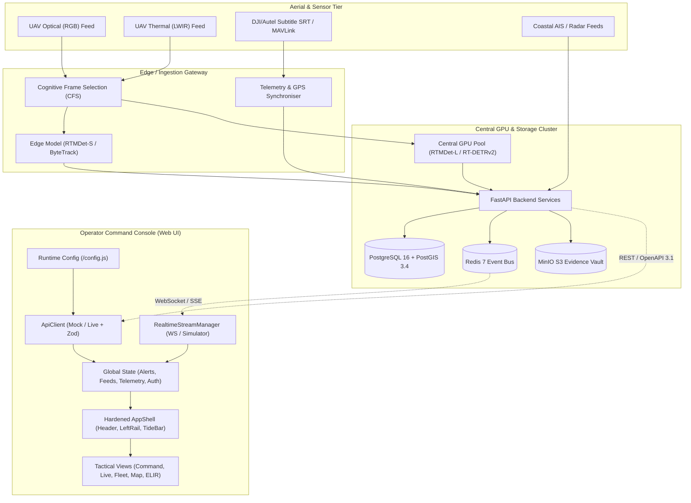

# SmartQEye Coastal — System Architecture Documentation

**System:** SmartQEye Coastal (AI-Based Coastal Drone Surveillance & Video Analytics)  
**Authority:** Kerala Police Coastal Police / Cyber Division – Drone Forensic Lab  
**Procurement Reference:** Kerala Startup Mission (KSUM) RFP  
**Version:** v0.9.0-prod-mvp  
**Classification:** RESTRICTED — OFFICIAL USE ONLY  

---

## 1. High-Level Architectural Overview

SmartQEye Coastal is designed as a resilient, air-gapped, multi-tier intelligence platform for coastal maritime surveillance across Kerala's 580 km coastline. The system decouples frontend presentation from backend computation and video ingestion, allowing field deployment in edge patrol boats, coastal police stations, and central command headquarters.

---

## 2. Platform Deployment Models

SmartQEye Coastal formally supports four deployment tiers while maintaining a uniform, centralized monitoring invariant:

| Deployment Model | Compute Placement | Video Ingestion | Network Requirement | Primary Operational Use Case |
| :--- | :--- | :--- | :--- | :--- |
| **Model 1: Central GPU + Gateway (Preferred)** | High-density GPU cluster at Police HQ | Ingestion gateway at coastal station / GCS | 4G/5G/Fiber (≥ 20 Mbps per feed) | Unified monitoring of Vizhinjam, Kochi, and Beypore sectors |
| **Model 2: Local Edge + Central Sync (Practical)** | Ruggedised edge laptop (RTX 4060/4080) | Direct USB/HDMI/Ethernet capture card | Intermittent 4G or post-mission sync | Remote patrol vessels, forward coastal posts during severe weather |
| **Model 3: Cooperative Edge (Optional)** | Dynamic worker pool of authenticated laptops | Edge laptops share analytical load | Secure LAN / Tactical Wi-Fi mesh | Multi-drone coordinated search & rescue operations |
| **Model 4: UAV-Onboard Compute (Future)** | Jetson Orin Nano mounted on drone payload | Native on-gimbal camera stream | Ultra-low bandwidth telemetry link only | Deep offshore interdiction beyond standard terrestrial RF range |

---

## 3. Client Architecture & Component Hierarchy

### 3.1 Hardened App Shell (`src/components/AppShell.tsx`)
The UI shell is built around zero-ambiguity police operations:
- **Top Classification Bar**: Permanent `RESTRICTED — AUTHORISED USE ONLY` security notice.
- **Top Command Header**: Collapsible navigation toggle, breadcrumb hierarchy, `Ctrl+K` global search palette (powered by `cmdk`), real-time IST operational clock, connectivity & processing-mode status pill, active alert triage slide-over drawer, language selector (English / മലയാളം), and user profile switcher.
- **Left Tactical Rail**: Thematic grouping (`Operations`, `Intelligence`, `Evidence & Review`, `Configuration`, `Platform`) with unread alert badges, attention count indicators, and collapsible icon-only mode with tooltips.
- **Main View Area**: Protected by `RouteErrorBoundary` to isolate render errors per route without tearing down the global command shell.
- **Bottom TideBar Footer**: Continuous health diagnostics showing Feeds Online, GPU Load, Storage Utilization, Edge Node sync, Active Model Bundle (`RTMDet-L v2.4.1`), and Last Sync timestamp.

### 3.2 State Management & Reactive Telemetry
- **Zustand Global Stores**:
  - `useAuthStore`: Role-based access control (RBAC), 15×7 permissions matrix, session timeout monitoring (15 min idle).
  - `useAlertStore`: Operational alerts queue, critical notification banner, unread counters.
  - `useFeedStore`: 20-32 feed metadata, active feed selection, grid layout (`1x1`, `2x2`, `3x3`, `4x4`), and modality overrides (`RGB`, `THERMAL`, `SPLIT`).
  - `useMapStore`: Coordinate projections, GIS layer toggles, range rings, zone polygons.
  - `useMissionStore`: Sortie parameters, pre-flight checklist verification, corridor deviation.
  - `useHealthStore`: CPU, GPU, VRAM, disk, network, and node cluster diagnostics.
- **Realtime Stream Abstraction (`src/lib/realtime.ts`)**:
  - Encapsulates WebSocket and Server-Sent Events (SSE).
  - Seamlessly toggles between local simulated event bus and remote live backend without modifying view components.
  - Telemetry bridge maps time-stamped flight data (`lat`, `lon`, `altM`, `speedMs`, `headingDeg`, `gimbalPitchDeg`) directly to HUD overlays and mini-maps.

---

## 4. API Contract & Data Validation

The frontend communicates with backend services via a strongly typed API client:
- **Specification**: Driven by `docs/openapi.yaml` (OpenAPI 3.1 standard).
- **Environment Agnostic**:
  - `VITE_API_MODE=mock`: Uses local deterministic mocks (`src/lib/mockData.ts`, `src/lib/incidentsData.ts`).
  - `VITE_API_MODE=live`: Activates `LiveApiClient` with bearer JWT authentication, automatic token refresh, exponential backoff retries, and unified HTTP error wrapping.
- **Zod Runtime Validation (`src/lib/schemas.ts`)**:
  - Strict payload validation across alerts, contacts, telemetry samples, missions, zones, audit records, and system health.
- **Query Key Factory (`src/lib/queryKeys.ts`)**:
  - Centralized React Query key hierarchy preventing cache collisions and simplifying invalidation.

---

## 5. Security & Air-Gapped Invariants

1. **Zero External CDN Dependencies**: All web fonts (`@fontsource/manrope`, `@fontsource/fraunces`, `@fontsource/jetbrains-mono`), icons (`lucide-react`), and GIS geometries are bundled locally.
2. **Immutable Audit Ledger**: Every operator action, export, threshold adjustment, and status modification is cryptographically hashed with SHA-256 and chained into the audit log.
3. **Court-Admissible Evidence Sealing**: Evidence packages (ZIP) contain cryptographic checksums (`manifest.json`), Section 65B Indian Evidence Act / Section 63 Bharatiya Sakshya Adhiniyam compliance certificates, and uncompressed telemetry logs.
4. **Human-in-the-Loop Safeguard**: Operator feedback or false-positive markings queue exclusively for offline review; deployed inference weights are never modified automatically at runtime.
