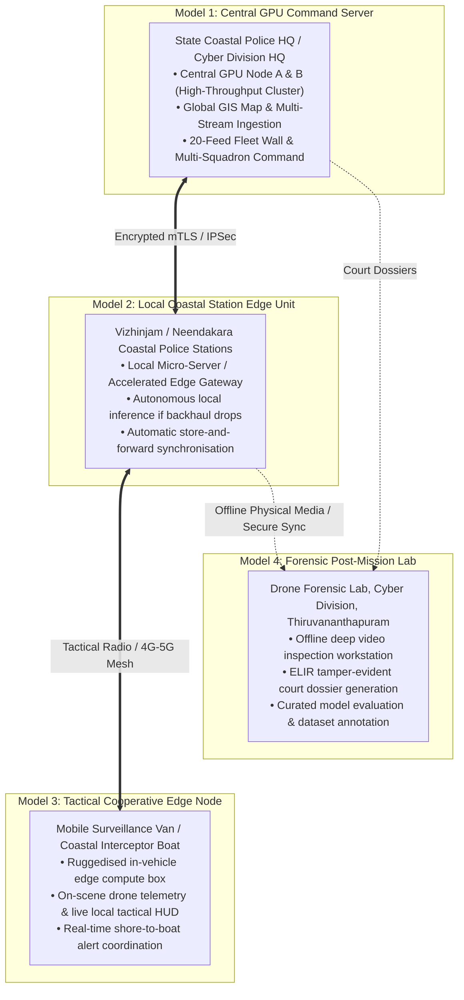

# SmartQEye Coastal — System Architecture & Tactical Intelligence Flow

**Quantumweave Intelligence Pvt. Ltd. (Thiruvananthapuram)**  
**Kerala Police Coastal Police / Cyber Division – Drone Forensic Lab**  
**KSUM RFP: "AI-Based Coastal Drone Surveillance and Video Analytics Software"**

---

## 1. Tactical Intelligence Pipeline Flow

The SmartQEye Coastal platform implements a 9-stage sequential intelligence pipeline. The diagram below maps the data flow from physical sensors through cognitive selection, multi-object tracking, contextual intelligence, to human-authorised operational response.

```mermaid
flowchart TD
    Sensors["Drone RGB / Thermal Video + Telemetry\n(UAV-KL-01..06 · 1080p/720p @ 25 FPS)"] --> CFS

    subgraph Compute_Optimisation ["Compute Optimisation Layer"]
        CFS["Cognitive Frame Selection (CFS)\nDynamic 8–25 FPS Skip Rate\n(Saves ~68% GPU VRAM during quiescent patrol)"]
    end

    subgraph Detection_Tracking ["Perception & Tracking Layer"]
        CFS --> DetTrack["AI Detection & Multi-Object Tracking\n• RTMDet-L / RTMDet-S (MMDetection, Apache-2.0)\n• RT-DETRv2 (Apache-2.0)\n• ByteTrack (MIT)"]
        DetTrack --> Contacts["Persistent Coastal Contact\n• Multi-camera spatio-temporal association\n• Track continuity scoring (>85% target)\n• Kerala artisanal & commercial craft taxonomy"]
    end

    subgraph Context_Intelligence ["Coastal Context Intelligence Layer"]
        Contacts --> Context["Kerala Coastal Context Intelligence\n• Geofenced zones (Z-01..07 Vizhinjam/Kovalam/Poovar)\n• Dwell timers & nautical speed baselines\n• High-tide lines & artisanal fishing schedules"]
        Context --> Behaviour["Temporal & Cross-Contact Behaviour Intelligence\n• Shoreline approach frequency\n• Vessel convergence & co-travel analysis\n• Stationary abandoned cargo detection"]
    end

    subgraph Attention_Evidence ["Operational Attention & Evidence Capture"]
        Behaviour --> Attention["Context-Aware Operational Attention\n• Dynamic severity ranking (CRITICAL, HIGH, MED, LOW)\n• Tactical prioritisation & queue triage"]
        Attention --> CKFE["Cognitive Keyframe Extraction (CKFE)\n• Post-event keyframe harvester (RGB + Thermal)\n• Pre/post-roll incident clip (90s window)\n• Sidecar JSON metadata"]
    end

    subgraph Incident_Governance ["Governance & Human-in-the-Loop Response"]
        CKFE --> ELIR["GIS-Linked Alert & ELIR\n• Evidence-Linked Incident Record\n• Tamper-evident SHA-256 integrity hash\n• Station & investigating officer assignment"]
        ELIR --> HumanPolice["Human Police Interpretation\n• Mandatory officer confirmation dialog\n• Logged operational rationale written to audit trail\n• Operational decisions always rest with authorised police"]
    end

    classDef primary fill:#e6f4f1,stroke:#0d9488,stroke-width:2px,color:#0f172a;
    classDef caution fill:#fef3c7,stroke:#d97706,stroke-width:2px,color:#0f172a;
    classDef police fill:#ede9fe,stroke:#7c3aed,stroke-width:2px,color:#0f172a;

    class CFS,CKFE caution;
    class DetTrack,Contacts,Context,Behaviour,Attention,ELIR primary;
    class HumanPolice police;
```

---

## 2. Four Approved Deployment Architectures (RFP §5)

To meet the physical operational realities of Kerala's 590 km coastline, SmartQEye Coastal supports four distinct, interoperable deployment models:

---

## 3. Key Pipeline Distinctions

### Cognitive Frame Selection (CFS) vs. Cognitive Keyframe Extraction (CKFE)

| Feature | Cognitive Frame Selection (CFS) | Cognitive Keyframe Extraction (CKFE) |
|---|---|---|
| **Pipeline Position** | **Pre-Inference** (Front-end frame ingestion) | **Post-Inference** (Post-event evidence generation) |
| **Primary Objective** | Compute & memory conservation | Evidence preservation & court admissibility |
| **Mechanism** | Dynamically skips quiescent background frames (dropping from 25 FPS to 8 FPS) until motion/bounding box exceeds baseline | Extracts optimal high-contrast frames, ±90s pre/post roll video, and structured JSON telemetry |
| **Output** | Streamlined frame tensor fed into RTMDet/ByteTrack | Immutable Evidence-Linked Incident Record (ELIR) signed with SHA-256 |
| **System Benefit** | Reduces GPU VRAM load by ~68% on 20 concurrent feeds | Minimises court video file sizes while retaining forensic fidelity |

---

## 4. Legal & Regulatory Compliance Safeguards

1. **Human Operational Supremacy**: AI models generate recommendations only. No weaponised, kinetic, or siren automation is permitted. Every tactical response (e.g. "Recommend patrol response", "Notify duty officer") triggers an officer confirmation dialog requiring a mandatory operational reason.
2. **Descriptive Non-Prejudicial Output**: The platform outputs observable physical behaviours (e.g. "Unscheduled nocturnal beach approach", "Vessel loitering in restricted anchorage"), never legal conclusions or characterisations of intent ("suspect", "smuggler", "criminal").
3. **Court-Admissible Evidence Dossiers**: All generated ELIR dossiers include cryptographic SHA-256 hashes for video clips, individual keyframes, and the master JSON manifest, establishing an unbroken chain of custody under the Indian Evidence Act.
4. **Air-Gapped Operation**: System binaries, weights, fonts, and cartographic layers are packaged for 100% offline deployment with zero external network connectivity.
