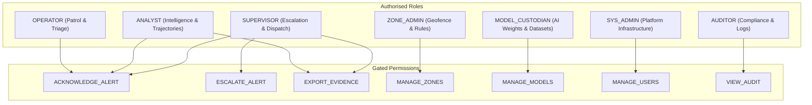

# SmartQEye Coastal — Security & Compliance Architecture

**System:** SmartQEye Coastal  
**Target:** Kerala Police Coastal Operations & Cyber Division – Drone Forensic Lab  
**Compliance Standards:** CERT-In Cyber Security Directions 2022 · DPDP Act 2023 · Sec 65B IEA / Sec 63 BNSS  
**Version:** v0.9.0-prod-mvp  
**Classification:** RESTRICTED — OFFICIAL USE ONLY  

---

## 1. Regulatory & Statutory Alignment

SmartQEye Coastal is engineered to conform to strict Indian law enforcement, statutory, and digital forensics requirements:

| Mandate / Statute | Regulatory Authority | Platform Implementation |
| :--- | :--- | :--- |
| **CERT-In Directives 2022** | Ministry of Electronics & IT (MeitY) | Synchronised NTP time to Indian Standard Time (IST); immutable audit ledger retained for legal periods; strict session timeout after 15 min inactivity; brute-force lockout after 3 failed attempts. |
| **Section 65B Indian Evidence Act / Section 63 BNSS** | Judiciary of India / Forensic Standards | Automated electronic evidence sealing with client-side SHA-256 integrity verification; unmodifiable flight telemetry CSV and keyframe hashes packaged in cryptographically signed ZIP archives. |
| **DPDP Act 2023** | Data Protection Board of India | Role-gated biometric & surveillance queries (Person Re-ID, face search, ANPR); explicit purpose requirement for sensitive exports; strict zero-automated-retraining safeguard protecting civilian rights. |

---

## 2. Role-Based Access Control (RBAC) & Governance

The platform implements a fine-grained 15-permission matrix across 7 operational Kerala Police roles:



### 2.1 Permission Enforcement Matrix
- `OPERATOR`: Tactical triage, playback, routine acknowledgment of low-severity events.
- `ANALYST`: Deep trajectory analysis, behavioral clustering, Section 65B dossier export.
- `SUPERVISOR`: Operational escalation, inter-agency tactical dispatch, false-positive authorization.
- `ZONE_ADMIN`: Geofence boundary authoring, Kerala coastal context profile configuration.
- `SYS_ADMIN`: User lifecycle management, node cluster health, system backup & recovery.
- `MODEL_CUSTODIAN`: Model bundle registration, staged rollout, model rollback, dataset curation.
- `AUDITOR`: Independent read-only verification of cryptographic audit logs and access history.

---

## 3. Session Security & Brute-Force Prevention

1. **Multi-Factor Authentication (MFA)**:
   - Mandatory two-factor authentication via TOTP hardware token or police authenticator app.
   - Separate verification step prevents credential stuffing attacks.
2. **Brute-Force Lockout**:
   - Workstation locks automatically for 60 seconds after 3 consecutive failed login attempts.
   - Lockout events are logged to the audit system with client IP and user agent.
3. **15-Minute Inactivity Timeout**:
   - The UI continuously monitors operator keyboard and pointer activity.
   - If no activity is detected for 15 minutes, the interface displays a security prompt requiring re-authentication or terminates the active session.
4. **Active Session Management**:
   - System Administrators can inspect active browser sessions and remotely terminate compromised or abandoned terminals in real time.

---

## 4. Cryptographic Audit Ledger & Chain of Custody

All security-critical actions generate an immutable log entry containing:
- ISO 8601 UTC timestamp and IST offset.
- User ID, authenticated role, and workstation IP.
- Operational action class (`ALERT_ACKNOWLEDGE`, `ZONE_CREATE`, `MODEL_ROLLBACK`, `EVIDENCE_EXPORT`).
- Target object identifier.
- SHA-256 block hash incorporating the previous block's hash ($H_n = \text{SHA256}(H_{n-1} + \text{Data}_n)$).

### Genesis-to-Head Verification
The Audit Console (`/audit`) provides an interactive in-browser cryptographic verifier. Operators can trigger an automated audit that traverses the entire blockchain ledger, re-computes all SHA-256 checksums using Web Crypto API, and verifies block continuity.

---

## 5. Web Application Security Headers

The Nginx web server enforces strict HTTP security headers:

```nginx
# Prevent clickjacking and UI redress attacks
add_header X-Frame-Options "DENY" always;

# Prevent MIME type sniffing
add_header X-Content-Type-Options "nosniff" always;

# Restrict referrer leakage across origins
add_header Referrer-Policy "strict-origin-when-cross-origin" always;

# Disable browser access to unneeded device capabilities
add_header Permissions-Policy "camera=(), microphone=(), geolocation=(), payment=()" always;

# Comprehensive Content Security Policy (CSP)
add_header Content-Security-Policy "default-src 'self'; script-src 'self' 'unsafe-inline' 'unsafe-eval'; style-src 'self' 'unsafe-inline'; img-src 'self' data: blob:; font-src 'self' data:; connect-src 'self' ws: wss:; media-src 'self' blob: data:; object-src 'none'; frame-ancestors 'none'; base-uri 'self'; form-action 'self';" always;
```

---

## 6. Audited Destructive Actions (`ConfirmDialog`)

All irreversible and sensitive actions—including zone deletion, rule deactivation, model rollbacks, user suspension, and false-positive flagging—are strictly protected by the `ConfirmDialog` component:
1. **Mandatory Reason Capture**: Operators must input an operational justification (minimum 8 characters).
2. **Audit Logging**: The action, reason, and actor are dispatched directly to the audit API.
3. **Two-Step Confirmation**: Visual confirmation warning matches action severity.
