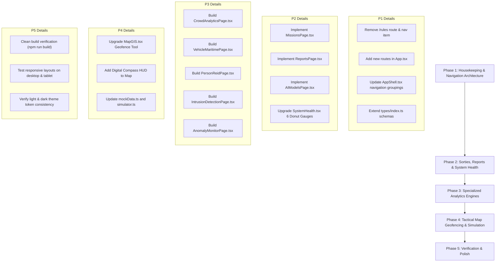

# SmartQEye Coastal — UI Architecture & Implementation Plan
**Document Reference:** `D:\SmartQEye_Costal\Costal Police .docx`  
**Platform:** Kerala Police — Coastal Drone Surveillance & Tactical Intelligence Platform  
**Target Project:** `D:\SmartQEye_Costal\smartqeye-coastal`  
**Date:** October 2026

---

## 1. Executive Summary

This plan outlines the complete UI refactoring, page removals, and page additions required for the **SmartQEye Coastal** operator dashboard based on the specification in `Costal Police .docx`. 

The update transitions the platform from generic prototype stubs to a comprehensive, mission-ready tactical operations system featuring **real-time AI video analytics, sortie mission management, multi-camera computer vision, and specialized forensic tools** designed specifically for Kerala Police Coastal Operations.

### High-Level Summary of Changes:
1. **Removed Pages**:
   - ❌ **Rules Page (`/rules`)**: Fully decommissioned and removed from routes and navigation.
2. **Transformed from Stubs to Full Production UI**:
   - 🚀 **Missions Page (`/missions`)**: Full sortie setup, standardized Mission ID generator (`MSN-YYYYMMDD-HHMM-SS-SQUADRON`), live status banner, video source selector (RTMP/RTSP/Upload + .srt), transmission controls, and historical mission log.
   - 🚀 **Reports Page (`/reports`)**: On-demand generator for 4 formal Kerala Police reports (Daily Incident Summary, Weekly SLA Audit, 30-Day Fleet Utilization, Mission After-Action Report AAR) with PDF download ledger.
   - 🚀 **AI Models Page (`/models`)**: GPU cluster model management (RTMDet-x, RT-DETRv2, ByteTrack, OSNet-IBN, ANPR OCR, CSRNet), hot-swap toggles, and live status pills per drone feed.
3. **New Specialized AI Analytics Pages Added**:
   - 🌟 **Crowd Analytics (`/crowd-analytics`)**: Head count KPIs, live density heatmaps, 24h area timeline chart, density level distribution table, surge/stampede threshold alarms, PDF/CSV export.
   - 🌟 **Vehicle & Maritime Analytics (`/vehicle-maritime`)**: Dual-mode segmented switcher:
     - *Mode 1 (Vehicle & ANPR)*: Dual raw/annotated video, 5 KPI cards, real-time ANPR recognition ledger, CSV exports.
     - *Mode 2 (Maritime Vessel Tracking)*: 4 KPI cards, vessel trajectory vectors, cruising vs. anchored classification, collision proximity alerts (<90px separation).
   - 🌟 **Person Tracking & Re-ID (`/person-reid`)**: Cross-camera person re-identification, MinIO face crop gallery, 6 KPI cards, suspect watchlist alert hits, appearance feature inspector.
   - 🌟 **Intrusion Detection (`/intrusion-detection`)**: Virtual geofencing polygons for restricted/VIP zones, real-time boundary breach alarms, historical intrusion review timeline with thumbnail snapshots and JSON exports.
   - 🌟 **Anomaly Monitor (`/anomaly-monitor`)**: Behavioral pattern analysis for person anomalies (loitering, fleeing, falls, weapons) and traffic anomalies (wrong-way driving, abrupt stops, erratic speeding) with risk scores and instant clip replay.
4. **Enhanced Existing Core Pages**:
   - 🔄 **System Health (`/health`)**: Upgraded to 6 SVG hardware donut gauges (CPU %, CPU Temp °C, GPU Compute %, GPU Temp °C, RAM %, SSD %) + rolling timeline telemetry graph.
   - 🔄 **Tactical Map (`/map`)**: Upgraded with interactive geofence polygon tool, digital compass heading indicator, telemetry readouts (Lat, Lon, Alt, Speed, Battery, HDOP), and drone quick-focus tracking.

---

## 2. Updated Navigation & Route Hierarchy

### 2.1 Navigation Structure (`AppShell.tsx`)

The navigation in the sidebar will be organized into logical operator sections:

```
┌────────────────────────────────────────────────────────┐
│ SMARTQEYE COASTAL — HARBOUR BAR                       │
├──────────────────────┬─────────────────────────────────┤
│ SIDEBAR NAVIGATION   │ VIEWPORT / WORKSPACE            │
│                      │                                 │
│ ── TACTICAL OPS ──   │                                 │
│ ▤ Command Center (/) │                                 │
│ 🖵 Live Monitoring   │                                 │
│ 🗺 Tactical Map       │                                 │
│ ⚓ Missions           │                                 │
│ 🔔 Alerts & Queue    │                                 │
│                      │                                 │
│ ── AI ANALYTICS ──   │                                 │
│ 👥 Crowd Analytics   │                                 │
│ 🚢 Vehicle & Marine  │                                 │
│ 👤 Person Re-ID      │                                 │
│ 🛑 Intrusion Detect  │                                 │
│ ⚠ Anomaly Monitor   │                                 │
│                      │                                 │
│ ── GOVERNANCE ──     │                                 │
│ 🧠 AI Models         │                                 │
│ 📄 Reports           │                                 │
│ ⏱ History Playback  │                                 │
│ 🩺 System Health     │                                 │
│ ⚙ Admin              │                                 │
└──────────────────────┴─────────────────────────────────┘
```

### 2.2 Route Table (`App.tsx`)

| Path | Component | Status | Description |
|------|-----------|--------|-------------|
| `/` | `CommandCenter` | Existing | Tactical home overview (map + alert queue + feed wall) |
| `/live` | `LiveMonitor` | Enhanced | Multi-grid (2×2, 3×3, 1+N focus), real-time overlays & telemetry badges |
| `/map` | `MapGIS` | Enhanced | GIS map + geofence polygon tool + digital compass + drone quick-focus |
| `/missions` | `MissionsPage` | **NEW Implementation** | Sortie setup, ID generator, video source selector, transmission controls |
| `/alerts` | `AlertQueue` | Existing | Ranked alert triage table + keyboard navigation |
| `/alerts/:id` | `AlertDetail` | Existing | Evidence-linked incident record (ELIR) |
| `/crowd-analytics` | `CrowdAnalyticsPage` | **NEW Page** | Crowd count, CSRNet heatmap, 24h area trend chart, surge alerts |
| `/vehicle-maritime` | `VehicleMaritimePage` | **NEW Page** | Segmented ANPR + Maritime vessel tracking, dual video, plate ledger |
| `/person-reid` | `PersonReidPage` | **NEW Page** | Cross-camera person Re-ID, face crop gallery, watchlist hits |
| `/intrusion-detection` | `IntrusionDetectionPage` | **NEW Page** | Polygon geofence breaches, real-time perimeter alarms, review timeline |
| `/anomaly-monitor` | `AnomalyMonitorPage` | **NEW Page** | Abnormal behavior detection (person/traffic), risk scores, clip replay |
| `/models` | `AIModelsPage` | **NEW Implementation** | GPU cluster model hot-swap, RTMDet/CSRNet/OSNet-IBN feed toggles |
| `/reports` | `ReportsPage` | **NEW Implementation** | 4 formal police reports generator (PDF), audit ledger |
| `/history` | `HistoryPlayback` | Existing | Faceted historical search, list/map/timeline views |
| `/health` | `SystemHealth` | Enhanced | 6 hardware SVG donut gauges + rolling timeline graph |
| `/admin` | `ComingSoon` | Retained Stub | Administrative settings and RBAC |
| `/rules` | **REMOVED** | **DELETED** | Explicitly deleted as instructed |

---

## 3. Detailed Specifications for New & Modified Pages

### 3.1 Missions Page (`/missions`)
**Location:** `src/features/missions/MissionsPage.tsx`
- **Active Mission Status Banner (Top)**:
  - Live status indicator (ACTIVE / STANDBY).
  - Assigned Drone ID (e.g. `UAV-KL-01 DJI Matrice 350 RTK`).
  - Squadron badge (`ALPHA`, `BRAVO`, `CHARLIE`, `DELTA`).
  - Red "Stop Mission" emergency termination button with confirmation dialog.
- **Main Center Layout (Split 2 Columns)**:
  - **Left Form (Sortie Setup)**:
    - Mission Name input (e.g., *Vizhinjam Harbor Dawn Patrol*).
    - Auto-generated Mission ID in format: `MSN-YYYYMMDD-HHMM-SS-SQUADRON` with instant refresh/regenerate button.
    - Video Source Type Selector:
      - `RTMP Live Stream` (URL field)
      - `RTSP Stream` (RTSP endpoint field)
      - `Raw Video Upload` (MP4/TS/MKV drag & drop)
    - Subtitle File Upload: DJI / Autel `.srt` telemetry subtitle file parser.
    - Pilot Name input.
    - Deployment Location (e.g., *Vizhinjam Coastal Police Station*).
    - Squadron selector (`ALPHA`, `BRAVO`, `CHARLIE`, `DELTA`) with station defaults.
    - "Start Mission Sortie" primary action button.
  - **Right Panel (Transmission & Pipeline Controls)**:
    - **Server Ingestion Toggle**: Enable/disable raw telemetry & RTSP ingestion to media gateway.
    - **Cognitive Pipeline Bypass Toggle**: Bypass heavy neural inferencing for raw recording/bandwidth saving.
    - Stream health indicator (Bitrate, FPS, Packet Loss).
- **Historical Mission Log Table (Bottom)**:
  - Columns: Mission ID, Name, Pilot, Squadron, Duration, Video Source, Status, Created At, Actions (View Detail, Delete Sortie).

---

### 3.2 Crowd Analytics Page (`/crowd-analytics`)
**Location:** `src/features/crowd/CrowdAnalyticsPage.tsx`
- **Top Controls**:
  - Drone feed selector pills (`UAV-KL-01`, `UAV-KL-02`, etc.).
  - Model selector dropdown: `CSRNet Part A (Dense)`, `CSRNet Part B (Sparse)`, `DM-Count`, `RTMDet-Crowd`.
  - Date/time range selector.
  - Export buttons: "Export PDF Report" & "Export CSV Data".
- **4 KPI Cards Strip**:
  1. `CURRENT COUNT`: Real-time head count with trend arrow (`↑ Increasing`, `↓ Decreasing`) and delta %.
  2. `PEAK COUNT`: Highest observed count with exact timestamp (e.g., *1,842 at 18:45 IST*).
  3. `DRONE ALERTS ACTIVE`: Threshold violation counter (Crowd surge / density exceeded).
  4. `DENSITY STATUS`: Categorical rating (`LOW`, `MEDIUM`, `HIGH`, `CRITICAL`) with numerical density metric (`p/m²`).
- **Workspace Center (60% / 40% Split)**:
  - **Left (60%)**: Live camera stream with interactive toggleable **Density Heatmap overlay** (color gradient from cool cyan to hot red overlayed on live video).
  - **Right (40%)**: Crowd Density Area Chart (24-hour timeline trend with alert threshold reference line, powered by Recharts).
- **Bottom Section**:
  - **Density Level Distribution Table**: Zone-by-zone density breakdown (Zone name, Area m², Total count, Density p/m², Status).
  - **Alert Incident Log**: Recent crowd alerts (Surge detected, Bottleneck warning, Stampede risk).

---

### 3.3 Vehicle & Maritime Analytics Page (`/vehicle-maritime`)
**Location:** `src/features/vehicle-maritime/VehicleMaritimePage.tsx`
- **Top Segmented Switcher**:
  - `[ 🚗 VEHICLE & ANPR ]` ⟷ `[ 🚢 MARITIME VESSEL TRACKING ]`

#### Mode 1: Vehicle & ANPR
- **5 KPI Cards**:
  1. `Vehicles Tracked`: Active tracks count (`text-violet-500`).
  2. `Moving / Stopped`: Cruising vs. stationary ratio (`text-teal-600`).
  3. `Avg Speed`: Average velocity in km/h (`text-amber-500`).
  4. `Plates Detected`: Cumulative license plate readings (`text-sky-600`).
  5. `Watchlist Matches`: Red alert counter for stolen/wanted vehicle hits (`text-red-600 animate-pulse`).
- **Main Split (55% / 45%)**:
  - **Left (55%)**: Dual-layer video feed (Raw feed vs. RTMDet-x + PaddleOCR annotated video showing vehicle bounding boxes and license plate crop tags).
  - **Right (45%)**: Real-time ANPR Ledger:
    - Search & filter bar by plate string.
    - Live feed table: Plate string, Vehicle class (Car/Bike/Truck/Bus), Confidence %, Thumbnail crop, Timestamp, Watchlist Status.
    - "Export CSV Ledger" button.

#### Mode 2: Maritime Vessel Tracking
- **4 KPI Cards**:
  1. `Live In Frame`: Number of craft currently in view.
  2. `Cumulative Tracks`: Unique vessels observed during deployment.
  3. `Motion Classification`: Ratio of Cruising vs. Anchored craft.
  4. `Proximity Alerts (24h)`: Collision / convergence warnings (<90px separation).
- **Sections**:
  - Live annotated marine stream with motion trajectory vectors and vessel classification tags (Fishing trawler, Speedboat, Cargo vessel, Dhow).
  - Vessel classification ledger table with Speed Over Ground (SOG), Course Over Ground (COG), and anchored status.
  - Marine density heatmap toggle and CSV track export.

---

### 3.4 Person Tracking & Re-ID Page (`/person-reid`)
**Location:** `src/features/person-reid/PersonReidPage.tsx`
- **Top Controls**:
  - Drone selector pills (`All Drones`, `UAV-KL-01`, `UAV-KL-02`, `UAV-KL-03`).
  - Live Face crop counter & SSE connection status badge.
- **6 KPI Cards Strip**:
  1. `Persons Tracked`: Active tracks for selected drone (`text-sky-600`).
  2. `Unique Identities`: Deduplicated identities across sorties (`text-violet-600`).
  3. `Faces Detected`: Total stored face crops (`text-amber-600`).
  4. `Watchlist Matches`: Suspect alert hits (`text-red-600 font-bold`).
  5. `Duplicates Removed`: Redundant frames suppressed (`text-emerald-600`).
  6. `Live Stream`: SSE connection status (`ACTIVE`).
- **Split Workspace**:
  - **Left (50%)**: Live annotated video showing person bounding boxes, persistent Track IDs, and Re-ID confidence vectors.
  - **Right (50%)**: Re-ID Gallery & Watchlist Ledger:
    - Face thumbnail gallery cards retrieved from MinIO storage.
    - Inspector modal: High-res face crop, similarity score %, cross-camera appearance timeline (Drone 1 @ 14:22 → Drone 2 @ 14:38), and download crop button.
    - Kerala Police suspect watchlist matching badge.

---

### 3.5 Intrusion Detection Page (`/intrusion-detection`)
**Location:** `src/features/intrusion/IntrusionDetectionPage.tsx`
- **Top Controls**:
  - Active Zone selector (e.g., *Vizhinjam Port Restricted Basin*, *Poovar Estuary Security Zone*).
  - Zone sensitivity slider & Alert buzzer toggle.
- **Main Workspace (Split View)**:
  - **Left (60%)**: Interactive tactical geofencing canvas showing real-time camera stream overlayed with virtual polygon boundaries (Green = Secured, Red = Breach Active).
  - **Right (40%)**: Live Intrusion Alarm Panel:
    - Real-time alert card with breach type (Unauthorized Person / Vehicle / Craft).
    - Dwell time counter.
    - Quick actions: "Acknowledge", "Dispatch Patrol Boat", "Trigger Siren".
- **Bottom Section**:
  - Historical Intrusion Review Timeline:
    - Paginated review table with snapshot thumbnails, entry/exit timestamps, target ID, and polygon ID.
    - "Export JSON Analytics" & "Export Incident Summary" buttons.

---

### 3.6 Anomaly Monitor Page (`/anomaly-monitor`)
**Location:** `src/features/anomaly/AnomalyMonitorPage.tsx`
- **Top Controls**:
  - Anomaly category filter: `All`, `Person Anomalies`, `Traffic Anomalies`, `Marine Anomalies`.
  - Sensitivity threshold selector (Low, Medium, High).
- **KPI Summary**:
  - Active Anomalies, High-Risk Events (24h), Average Risk Score, False Alarm Rate %.
- **Two-Column Analytics Hub**:
  - **Left (55%)**: Live Video Stream with Anomaly Bounding Highlight & Instant Clip Replay scrubber (jump back 10s/30s to breach point).
  - **Right (45%)**: Anomaly Event Stream:
    - **Person Anomalies**: Suspicious loitering (>5 min in restricted zone), running/fleeing, sudden falls, weapon brandishing.
    - **Traffic Anomalies**: Wrong-way driving, abrupt stops, erratic speeding.
    - Each event shows risk confidence score (0–100%), contributing factors badge, and "Mark False Positive" / "Escalate" buttons.
- **Bottom**: Rolling 24-hour Anomaly Timeline Trend Chart.

---

### 3.7 AI & Models Page (`/models`)
**Location:** `src/features/models/AIModelsPage.tsx`
- **Cluster Status Banner**:
  - GPU Cluster health (NVIDIA RTX 4090 / A100), Active Workers, Model VRAM Allocation, Total Inferences/sec.
- **Model Registry & Dynamic Deployment Matrix**:
  - Table of available neural network models:
    - `RTMDet-x / RT-DETRv2` — Object & Target Detection
    - `ByteTrack / BoT-SORT` — Multi-Object Tracking & Continuity
    - `FaceNet / ArcFace` — Face Recognition & Feature Vectors
    - `PaddleOCR / CRNN` — License Plate Recognition (ANPR)
    - `CSRNet / DM-Count` — Crowd Density Estimation
    - `SlowFast / VideoMAE` — Human Behavior Anomaly Analysis
  - Per-drone assignment matrix: Select which models run on `UAV-KL-01` through `UAV-KL-06`.
  - Hot-swap buttons: Start, Stop, or Restart model container with zero downtime.
  - Live status pills (`ACTIVE`, `STARTING`, `STOPPED`, `ERROR`).

---

### 3.8 Formal Reports Page (`/reports`)
**Location:** `src/features/reports/ReportsPage.tsx`
- **On-Demand Police Report Generators (4 Report Types)**:
  1. **Daily Incident Summary (PDF)**: Executive briefing of all observed contacts, raised alerts, and resolved incidents in the last 24h.
  2. **Weekly Response-Time & SLA Audit (PDF)**: Triage response metrics, operator acknowledgment latencies, escalation compliance for supervisory review.
  3. **Drone Utilisation (30-Day Fleet Analysis) (PDF)**: Flight hours, sortie count, battery lifecycle, maintenance schedule, and coverage heatmaps across the 6 UAVs.
  4. **Mission After-Action Report (AAR) (PDF)**: Comprehensive chronological sortie dossier with telemetry tracks, keyframe evidence, and pilot notes.
- **Generation Modal / Drawer**: Date range selector, UAV selector, Commanding Officer sign-off name, and "Generate Formal PDF" button.
- **Historical Generated Reports Ledger**:
  - Table: Report Title, Report Type, Generated At (IST), Period Covered, File Size (MB), Generated By, Download PDF button.

---

### 3.9 System Health Page (`/health`) Enhancements
**Location:** `src/features/health/SystemHealth.tsx`
- **Top Grid of 6 SVG Hardware Donut Gauges** (as specified in docx):
  1. `CPU Usage %` (Color-coded: Green <70%, Amber 70-85%, Red >85%)
  2. `CPU Temperature (°C)` (Color-coded: Normal <65°C, Warm 65-80°C, Hot >80°C)
  3. `GPU Compute %` (CUDA utilization)
  4. `GPU Temperature (°C)` (Thermal monitoring)
  5. `Memory (RAM) %` (Allocated / Total GB)
  6. `SSD Storage %` (Local fast buffer NVMe utilization)
- **Bottom Section**:
  - Multi-line rolling timeline graph tracking CPU, GPU, and RAM over the last 60 minutes.
  - Existing edge nodes & feed health tables preserved below.

---

### 3.10 Tactical Map Page (`/map`) Enhancements
**Location:** `src/features/map/MapGIS.tsx` & `src/components/CoastalMap.tsx`
- **Drone Quick-Focus Tracking**:
  - Left panel drone list with "Quick Focus" button that flies the camera to the drone's real-time position.
- **Digital Compass & Live Telemetry Readout**:
  - Floating HUD compass widget showing drone yaw heading.
  - Live telemetry readout strip: Latitude, Longitude, Altitude AGL, Ground Speed, Battery %, HDOP.
- **Interactive Geofence Polygon Tool**:
  - Draw custom polygon geofences directly on the map.
  - "Lock / Save Geofence" with name, security level, and alarm trigger rule.
  - Visual breach simulation: Highlights perimeter in flashing red when targets enter.

---

## 4. Data Models & State Additions

### 4.1 Type Definitions (`src/types/index.ts`)
New types to add:
- `MissionSortie`: Setup fields, video source config, squadron, transmission toggles, pilot name.
- `CrowdAnalyticsSample`: Head count, peak count, density rating, p/m² distribution.
- `VehicleTrack`: Plate string, vehicle type, speed km/h, watchlist match boolean.
- `MaritimeTrack`: Vessel type, SOG, COG, anchored status, proximity warning flag.
- `PersonReidRecord`: Person ID, face crop URI, appearance vectors, camera hops timeline.
- `IntrusionEvent`: Zone ID, breach target type, timestamp, dwell time, snapshot URI.
- `AnomalyEvent`: Anomaly type, risk confidence score (0-100%), video clip replay timestamp.
- `AiModelInfo`: Model name, task, VRAM MB, status (`RUNNING` | `STOPPED` | `HOT_SWAPPING`), assigned UAVs.
- `PoliceReportRecord`: Report type, title, generatedAt, fileSize, downloadUrl.

### 4.2 Mock Data & Simulator Updates (`src/lib/mockData.ts` & `src/lib/simulator.ts`)
- Add mock ANPR plate recognition event stream with realistic Kerala vehicle registration formats (`KL-01-AB-1234`).
- Add mock crowd density time-series samples for Kovalam Beach, Vizhinjam Port, and Shanghumukham Beach.
- Add mock face crops and suspect watchlist matches.
- Add real-time event generator hooks for live intrusions and behavior anomalies.

---

## 5. Phased Implementation Roadmap



### Detailed Phase Breakdown:

#### Phase 1: Navigation & Schema Housekeeping
1. Delete `/rules` route in `src/App.tsx`.
2. Remove `Rules` entry from `NAV_ITEMS` in `src/components/AppShell.tsx`.
3. Add route entries for all 5 new analytics pages and full implementations of `/missions`, `/reports`, `/models`.
4. Define comprehensive TypeScript interfaces in `src/types/index.ts`.

#### Phase 2: Operations Management & Governance
1. Build `src/features/missions/MissionsPage.tsx`:
   - Interactive sortie form with auto-generating Mission ID.
   - Video source selector (RTMP/RTSP/Upload) & `.srt` subtitle parser.
   - Active status banner with Stop Mission action.
   - Transmission toggles & historical log table.
2. Build `src/features/reports/ReportsPage.tsx`:
   - 4 formal report generation modals (Daily Incident, Weekly SLA, 30-Day Fleet, AAR).
   - Historical PDF ledger with simulated download action.
3. Build `src/features/models/AIModelsPage.tsx`:
   - GPU cluster summary & VRAM allocations.
   - Per-UAV model activation matrix with start/stop/hot-swap controls.
4. Upgrade `src/features/health/SystemHealth.tsx`:
   - Implement the 6 hardware SVG donut gauges (CPU %, CPU Temp, GPU %, GPU Temp, RAM %, SSD %).
   - Rolling resource consumption timeline graph.

#### Phase 3: Specialized AI Analytics Pages
1. Build `src/features/crowd/CrowdAnalyticsPage.tsx`:
   - 4 KPI cards, live camera + CSRNet density heatmap, 24h timeline area chart, density level table, CSV/PDF export.
2. Build `src/features/vehicle-maritime/VehicleMaritimePage.tsx`:
   - Segmented mode switcher: Vehicle & ANPR vs. Maritime Vessel Tracking.
   - 5 KPI cards for ANPR, dual annotated feed, real-time license plate ledger.
   - 4 KPI cards for Maritime, vessel classification, proximity warnings (<90px).
3. Build `src/features/person-reid/PersonReidPage.tsx`:
   - 6 KPI cards, cross-camera person tracking, face crop gallery with inspector modal, watchlist alert hits.
4. Build `src/features/intrusion/IntrusionDetectionPage.tsx`:
   - Dynamic polygon geofencing over live stream, real-time boundary breach alarm card, review timeline with JSON export.
5. Build `src/features/anomaly/AnomalyMonitorPage.tsx`:
   - Person & traffic anomaly detector, risk score badges, 10s/30s clip replay scrubber, timeline trend chart.

#### Phase 4: Tactical Map Upgrades & Real-Time Simulation
1. Upgrade `src/features/map/MapGIS.tsx` and `src/components/CoastalMap.tsx`:
   - Interactive polygon drawing tool for geofences.
   - Digital compass heading widget and telemetry HUD strip.
   - Quick-focus drone selector.
2. Enrich `src/lib/mockData.ts` and `src/lib/simulator.ts` with streaming data for all new analytics modules.

#### Phase 5: Verification & Delivery
1. Run `npm run build` to verify strict TypeScript adherence with zero compiler errors.
2. Confirm both Light Theme (`--sand-50`) and Dark Theme tokens look balanced and legible.
3. Verify keyboard accessibility and mobile/tablet responsive behavior.

---

## 6. Verification Checklist

- [ ] Rules page (`/rules`) is completely removed from navigation and routing.
- [ ] Missions page has live sortie status banner, auto Mission ID generator, source selector (RTMP/RTSP/upload + srt), and transmission toggles.
- [ ] Crowd Analytics page renders 4 KPIs, live stream with density heatmap overlay, and 24h Recharts timeline area chart.
- [ ] Vehicle & Maritime page supports segmented switching between ANPR ledger and marine vessel proximity tracking.
- [ ] Person Re-ID page displays 6 KPIs, live video, and face crop gallery with inspector.
- [ ] Intrusion Detection page displays virtual polygon boundaries and boundary breach alarms.
- [ ] Anomaly Monitor page categorizes person & traffic anomalies with instant clip replay.
- [ ] Reports page enables on-demand generation of all 4 formal police reports with PDF download ledger.
- [ ] AI Models page manages GPU cluster models (RTMDet-x, RT-DETRv2, ByteTrack, OSNet-IBN, ANPR, CSRNet) with per-feed hot-swap pills.
- [ ] System Health page features the 6 SVG hardware donut gauges and rolling timeline graph.
- [ ] Map page includes interactive geofence polygon tool, digital compass, and telemetry readout.
- [ ] Build succeeds with exit code 0 (`npm run build`).
